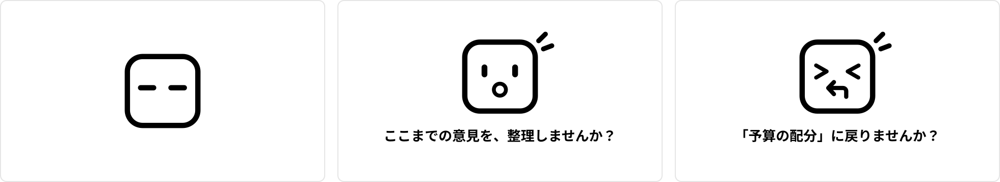
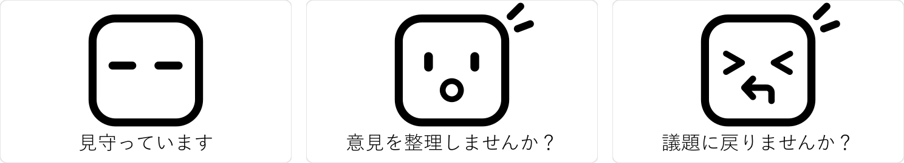
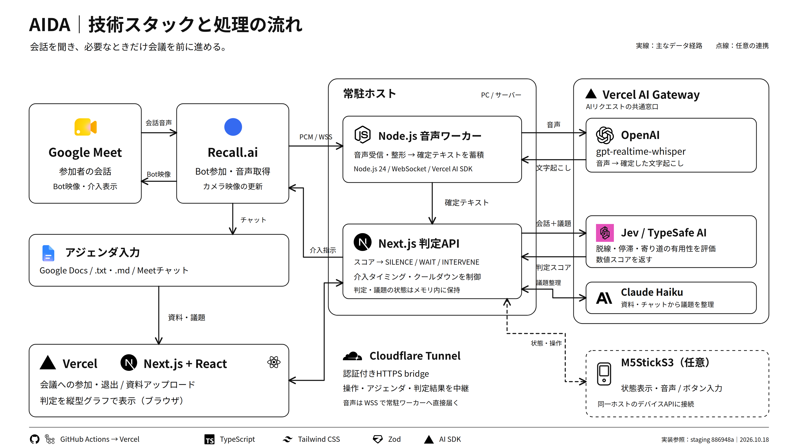

# **空気を読み、あいだに入る**

# *AIDA*

### *Ambient Intelligence, Discreet Agent.*

[デモ（URL未設定）](#) · [LP（URL未設定）](#)

[Jevチューニングの手法・最終評価](docs/jev-tuning/timeline.md)

## 目次

- [製品概要](#overview)
  - [背景](#background)
  - [製品説明](#product)
  - [特長](#features)
  - [解決出来ること](#solves)
  - [今後の展望](#future)
  - [注力したこと](#focus)
- [開発技術](#tech)
  - [活用した技術](#stack)
    - [API・データ](#api)
    - [フレームワーク・ライブラリ・モジュール](#frameworks)
    - [デバイス](#devices)
  - [独自技術](#original)
    - [ハッカソンで開発した独自機能・技術](#hack)

## 製品概要

---

### 背景

**ペルソナ**

仕事に必要な意思決定のため会議を前に進めたいが、コントロールが上手くいかない人

**課題**

アジェンダから話が発散したり堂々巡りして、時間が足りなくなることがある。
注意しようにも、上司や関係値の浅い人には言いにくい…

既存の AI ファシリテーターでは、発言の情報量や主張の強さによって議論の流れが止まり、鬱陶しいと感じることもある。

### 製品説明

AIDA（Ambient Intelligence, Discreet Agent）は、必要なときだけ議論を戻す AI ファシリテーターです。
空気のように会議に同席し、必要なときだけ手を貸します。
それ以外は端にいて、誰の出番も奪わず、有益な寄り道は止めず、進行の役を、特定の参加者には任せません。
参加者の心理的な負担を減らし、会議の邪魔をせず、そっと流れを整えることを目指します。

**画面と一言**

会議に映す画面は、見守る・話を戻す・きっかけをつくる、の三つの状態です。

- 見守っているあいだ：見守る画面
- 脱線で介入するとき：議題に戻す一言
- 停滞で介入するとき：意見の整理を促す一言

介入後は見守る画面に戻します。短い一言は画面に表示し、Meet 向けの音声読み上げは行いません。

対面の席に置く M5StickS3 にも、同じ表情を出します。

Jev は、停滞 `stalled`・脱線 `drifted`・寄り道の有用性 `tangentIsRelevant` と、いま介入すべきかを示す `interveneNow` の四つのスコアを返します。Next.js 側がそのスコアを閾値・条件に照らし、`SILENCE` / `WAIT` / `INTERVENE` を決めます。
有益な寄り道は脱線だけでは止めず、発言の途中には挟みません。

| スコアに基づく判定 | パラメータ | 閾値・条件 | 必要回数 |
| --- | --- | --- | --- |
| `INTERVENE`：整理を促す | 停滞 `stalled` | `stalled ≥ 0.6` ＋ `interveneNow ≥ 0.6` | 1回 |
| `INTERVENE`：議題に戻す | 脱線 `drifted` | `drifted ≥ 0.5` ＋ `tangentIsRelevant < 0.8` ＋ `interveneNow ≥ 0.6`。停滞による介入条件が未成立 | 1回 |
| `WAIT`：見守る | 脱線・停滞の観察 | `drifted ≥ 0.4` または `stalled ≥ 0.4`。介入条件は未成立 | 1回 |
| 見守る（脱線による介入を抑止） | 寄り道の有用性 `tangentIsRelevant` | `tangentIsRelevant ≥ 0.8`。停滞による介入は別途判定 | 1回 |
| `SILENCE`：見守る | 通常進行 | `drifted < 0.4` ＋ `stalled < 0.4` | 1回 |

| 表示ステータス | 判定・設定 | 表示に必要な回数 | 表示内容 |
| --- | --- | --- | --- |
| 整理を促す `stalled` | 停滞による `INTERVENE` | 1回 | 意見の整理を促すカード |
| 議題を戻す `off_agenda` | 脱線による `INTERVENE` | 同じ理由で連続2回。新しい確定テキストでの再判定が必要 | 議題に戻すカード |
| 現在の表示を維持 | `WAIT` / `SILENCE` | 介入表示なし | 現在の表示を維持 |
| 見守る `idle` | 介入表示の成功から8秒後 | ― | 見守るカード |

※ 脱線の2回目は前回の確認から20秒以内。同じ理由でなくなった場合や、途中で `WAIT` / `SILENCE` になった場合は確認をリセットします。議題変更や古くなった判定なども確認の対象から外します。

※ 条件成立後も発言の切れ目を待ちます。無音時間の既定値は1.5秒で、未処理の音声・文字起こしがある間も表示を待ちます。判定間隔の既定値は10秒です。
※ 実介入後60秒はクールダウンとして Jev を呼ばず `SILENCE`。クールダウン外でも確定テキスト3件未満では Jev を呼ばず `WAIT` になります。

設定・実装：[判定閾値](lib/judge/jev-policy.json)／[スコアからの判定](lib/judge/jev.ts)／[音声入力と介入表示の条件](scripts/transcription/pipeline.mjs)

#### Jevのチューニング

4つのフェーズに分け、LLM-as-a-Judge や Few-shot といった手法でチューニングを行いました。
クロスバリデーションや、テスト用データ作成・ラベル付け・検証の役割をコンテキストを共有しないエージェントへ分担する方法により、過学習や評価への情報漏洩を抑える工夫をしました。

| 最終評価 | 使用した技術・チューニング手法 | Validation一致率 | 最終Test・追加評価の一致率 | 比較の範囲 | 制約 |
| --- | --- | --- | --- | --- | --- |
| ① 実録で初期検証 | LLM-as-a-Judge・Few-shot・Prompt3種×閾値216組の探索・会議単位の分割 | 従来60% → 探索90%／採用75%（各20件） | 従来65% → 探索85%／採用70%（各20件） | 英語の実録会議・GPT参照ラベル | Test20件中19件がOK。表示制約により探索結果とは別設定を採用。 |
| ② 合成500件で最適化 | 独立GPTラベル・Train内5分割CV・Prompt/閾値探索・Validationで設定固定 | v3：99% → v4：100%（各100件） | 未使用Test：両設定100%（各100/100） | 日本語合成500件・GPT参照ラベル。300/100/100に系列分割 | 合成Testで80%目標達成。|
| ③ 別台本で追加検証 | ラベル付けとテストを別エージェントへ分担。固定済み設定を再調整せず比較 | 再探索なし | v3：94.08%（159/169）→ v4：95.86%（162/169） | PR #35の日本語台本169件・GPT参照ラベル | 不確実24件を含む。 |
| ④ staging版で最終確認 | v4を最新アプリへ統合。4質問・介入ゲートを維持し、Jev 1.14.0で再実測 | 再選択なし | **96.45%（163/169）** | ③と同じ169件・固定GPT参照ラベル | ③とは判定構成が異なる。 |

参照：[チューニングの手法・最終評価](docs/jev-tuning/timeline.md)／[staging 統合版の評価条件と制約](docs/jev-tuning/staging-rollout.md)

### 特長

**1. Zero-UI**

会議中、介入のたびに参加者が押して動かす画面は必要ありません。会議の席で察して動きます。
操作を参加者に渡すと、負担や責任がそこに残るためです。会議への参加やアジェンダの登録は事前に行います。

**2. 会議を邪魔しない、さりげない介入**

ユーザーに介入する方法は表情変化と文章のみ。余計な音声通知・議題の誘導などは行わず、会議の流れは止めません。

意味のある脱線も止めず、脱線を理由に止めるのは、議題から外れていてその寄り道に用がないと判断したときだけです。停滞は別に判定します。

**3. Jevの使用**

軽量かつ高速な判断モデル AI である Jev を使用し、必要なタイミングでの介入を目指します。音声の文字起こし、判定間隔、発言の切れ目の待機があるため、遅延がゼロになるわけではありません。

### 解決出来ること

**話がそれて、戻す一言が出ない**

それていると分かっていても、いまの発言を遮って言うのは負担です。その一言を AIDA が言うので、特定の参加者が進行役を背負わなくてよくなります。

**話が止まって、次へ進めない**

質問のあとに誰も返事をしないときや、同じ論点がもう一周しているときに、ここまでの意見を整理する一言を返します。

### 今後の展望

今の形は、オンラインの会議に参加者として座り、口を開くかどうかの判断に集中することです。

次に向き合う会議は、次のとおりです。

* アジェンダのない会議。今日決めることはあるのに、戻る先が書かれていない。話題がずれても、何に戻すかをその場の話から探すことになる。
* 対面の会議。同じ部屋に人が座っていて、戻す一言や整理を促す一言を、スピーカーから部屋に返す。

### 注力したこと（こだわり等）

- 介入のたびに参加者が押して動かす画面は置かない（Zero-UI）。会議の席で察して動き、必要なときだけ介入する
- 介入するか、黙るかの判断。チューニングと何回判定されたらステータスを変更するかを試行錯誤した
- 何度も介入しノイズにならないよう、一度介入したあと、しばらくは介入しない。この時間は、Meet への介入表示が成功した時点から数える

## 開発技術

---

音声は Recall.ai が Google Meet から受け取り、常駐する Node.js ワーカーへ送ります。ワーカーが Vercel AI Gateway 経由の OpenAI `gpt-realtime-whisper` で文字起こしし、確定テキストを Next.js に渡します。Next.js は Jev から受け取った四つのスコアで介入を判断し、Recall.ai を通じて会議に映す画面を切り替えます。

以下は音声 bridge を有効にした構成です。Vercel 上の Next.js と常駐ホストは、認証付きの bridge で連携します。M5StickS3 の連携は任意で、図のデバイス API に直接接続します。

### 活用した技術

#### API・データ

* Recall.ai。Google Meet への入室、文字起こし、チャット、映像
* Vercel AI Gateway。Jev への中継
* Jev（`typesafe-ai/jev`）。SILENCE / WAIT / INTERVENE の判断。脱線、停滞、寄り道の有用性

#### フレームワーク・ライブラリ・モジュール

* Next.js
* ブラウザの音声合成（Web Speech Synthesis）

#### デバイス

* 会議に映す画面は、Recall.ai の参加者映像
* 対面用のスピーカーは、今後の形

### 独自技術

#### ハッカソンで開発した独自機能・技術

* Jev から受け取った SILENCE / WAIT / INTERVENE で、会議への出し方を切り替える。[`lib/judge/jev.ts`](lib/judge/jev.ts)
* 会議の映像は、見守る画面、議題に戻す画面、整理を促す画面で切り替える。[`lib/recall/controller.ts`](lib/recall/controller.ts)
* 有益な寄り道では、脱線だけでは止めない
