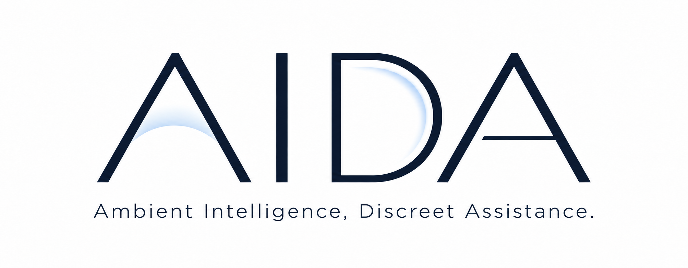

# AIDA ロゴコンセプト

**Ambient Intelligence, Discreet Assistance.**

## コンセプトコピー

**空気を読み、間に入る。**

## 説明文

AIDAのロゴは、会議の空気を読み、人と人の「間」に入る存在を表しています。

淡い青のグラデーションは、目には見えない空気や、会話の中に生まれる気配をイメージしています。文字の余白にやわらかくなじむことで、会議の流れを感じ取り、必要なときだけ支えるAIDAの姿を表現しました。

装飾を抑えた文字と広い余白は、AIDAが大切にする「静かな存在感」です。会議が順調なときは見守り、脱線や沈黙で進まなくなったときに、短いひとことで次の会話へつなぎます。

青い曲線がグラデーションで余白を満たすデザインでは、議論の間に入って意思決定を支えるAIDAの支援の姿を表現しています。余白を残したまま寄り添うかたちが、「Discreet Assistance（控えめな支援）」という考え方を伝えます。

## デザイン要素と意味

| 要素 | 表していること |
| --- | --- |
| 淡い青 | 空気、落ち着き、会話の微細な変化への気づき |
| 余白になじむグラデーション | 場に溶け込み、必要なときにだけ現れる支援 |
| 装飾のないI | 控えめな存在感 |
| 濃紺の文字とゆとりある字間 | 読みやすさ、信頼感、距離感 |

このロゴでは「間」を、文字同士の距離だけでなく、文字の内側にある空間と、会話の間合いの両方として捉えています。
